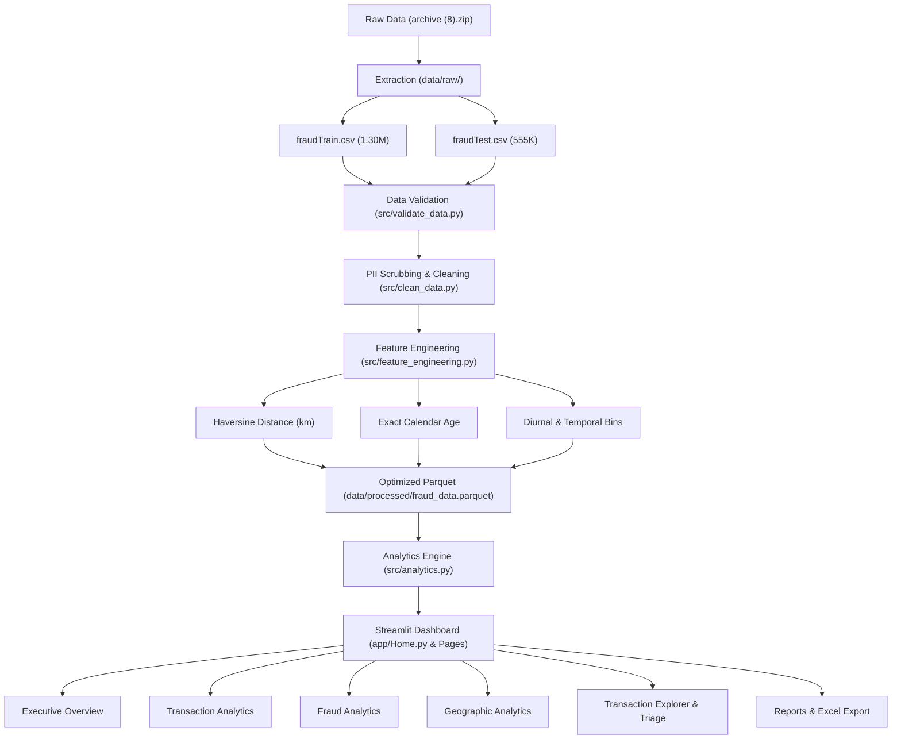

# 🛡️ Financial Fraud Detection Model
### *Data Analytics & Forensic Streamlit Dashboard*

[](https://python.org)
[](https://streamlit.io)
[](https://pandas.pydata.org)
[](https://plotly.com)
[](https://arrow.apache.org)
[](https://pytest.org)

---

## 📌 Executive Summary

The **Financial Fraud Detection Model (Data Analytics – Streamlit Dashboard)** is an enterprise-grade financial crime intelligence application. Engineered for financial forensic analysts, risk officers, and fraud triage specialists, this system moves beyond generic exploratory dashboards to provide deep forensic answers to core business questions across **1,852,394 validated historical transactions** (spanning 2019–2020).

Rather than relying on unvalidated black-box machine learning predictions, this platform emphasizes **data integrity, historical ground-truth analytics, and transparent heuristic investigation indicators**.

---

## 🎯 5 Core Business Questions Answered

| # | Strategic Business Question | Empirical Finding from Dataset |
| :-: | :--- | :--- |
| **1** | **How many financial transactions are happening?** | **1,852,394 total transactions** occurred across 2019–2020 representing **$129,785,336.00** ($129.79M) in gross processed volume. |
| **2** | **How many transactions are historically identified as fraudulent?** | **9,651 confirmed fraud transactions** were identified, establishing an overall baseline fraud incidence rate of **0.5210%**. |
| **3** | **What patterns are associated with fraudulent transactions?** | Fraudulent purchases average **$530.66**—nearly **7.84x higher** than legitimate purchases ($67.65). Fraud spikes sharply during late-night hours (**22:00–03:00**), peaking at **2.601%** at 22:00. |
| **4** | **Which categories, merchants, times, and locations show higher fraud?** | **`shopping_net`** has the highest fraud rate (**1.593%**), while **`grocery_pos`** has the highest raw fraud volume (**2,228 cases**). **New York** leads in raw fraud cases (730), and **Oregon** leads in rate (0.746% among major states). |
| **5** | **What insights can analysts use to investigate suspicious patterns?** | Priority triage rules: transactions over **$300**, physical cardholder-to-merchant distances exceeding **80 km**, purchases in high-risk categories, and late-night timestamps. |

---

## 🗄️ Dataset Provenance & Verification

The primary data source is `archive (8).zip`, comprised of two verified partitions:
- **`fraudTrain.csv`**: 1,296,675 transactions | 7,506 fraud labels (0.5789%) | Jan 1, 2019 – Jun 21, 2020
- **`fraudTest.csv`**: 555,719 transactions | 2,145 fraud labels (0.3860%) | Jun 21, 2020 – Dec 31, 2020
- **Combined Parquet**: **1,852,394 transactions** | **9,651 fraud labels** (0.5210%) | 0 missing cells | 0 duplicate rows

> **Note on `creditcard.csv`**: Maintained as an optional secondary dataset for comparative research. Not merged into this pipeline because it features an anonymized PCA structure (`V1`–`V28`) with fundamentally different schemas.

---

## 🏗️ Architecture & Data Pipeline



---

## 💻 Application Module Structure

The dashboard contains 6 cohesive analytical modules:

1. **Executive Overview (`app/Home.py`)**: High-level KPIs, monthly fraud trajectory, top vulnerable categories, diurnal attack intensity curve, and log-scale amount distributions.
2. **Transaction Analytics (`app/pages/1_Transaction_Analytics.py`)**: Detailed volume and dollar share across merchant categories, top active commercial entities, and demographic spending brackets.
3. **Fraud Analytics (`app/pages/2_Fraud_Analytics.py`)**: Forensic distinction between raw fraud counts and normalized fraud rates, weekly patterns, and the 7.84x amount disparity analysis.
4. **Geographic Analytics (`app/pages/3_Geographic_Analytics.py`)**: Interactive US state choropleth maps, regional risk rankings, and customer-to-merchant Haversine distance analysis.
5. **Transaction Explorer (`app/pages/4_Transaction_Explorer.py`)**: Interactive searchable ledger, multi-parameter heuristic rule scanner with composite risk scores, and external batch CSV file ingestion.
6. **Reports (`app/pages/5_Reports.py`)**: Executive KPI balance sheet, empirical policy directives, and downloadable CSV and formatted multi-tab Excel (`.xlsx`) analytical packs.

---

## ⚡ Quick Start & Execution

### 1. Prerequisites
- Python 3.11+
- Git

### 2. Setup Virtual Environment (Recommended)
```bash
# Clone or open repository
cd "c:\fraude diduction"

# Create virtual environment
python -m venv venv

# Activate on Windows
venv\Scripts\activate
# Activate on Linux/macOS
# source venv/bin/activate

# Install dependencies
pip install -r requirements.txt
```

### 3. Run Data Ingestion & Preprocessing
```bash
python -m src.clean_data
```
*Generates high-speed columnar Parquet storage (`data/processed/fraud_data.parquet`) in seconds.*

### 4. Launch the Streamlit Dashboard
```bash
streamlit run app/Home.py
```
*Opens automatically at `http://localhost:8501`.*

---

## 🧪 Automated Testing Suite

Comprehensive automated unit and regression tests validate data hygiene, Haversine geometry, exact age logic, KPI formulas, and investigation indicators:

```bash
# Run pytest suite
python -m pytest tests/ -v
```

**Results**: `13 passed in 0.56s` (100% test pass rate).

---

## 📈 Key Empirical Discoveries for Fraud Analysts

1. **The $530 vs $67 Disparity**:
   Historically identified fraudulent transactions have an average ticket of **$530.66**, compared to **$67.65** for legitimate purchases. While fraud constitutes only **0.52%** of transactions, it captures **3.95%** of total transaction dollars.
2. **The 22:00 Diurnal Surge**:
   Fraud is strongly concentrated in nocturnal hours. At **22:00 (10:00 PM)**, the fraud rate peaks at **2.601%** (over 5x the daytime rate), accounting for 2,481 confirmed cases.
3. **E-Commerce Risk Concentration**:
   `shopping_net` carries the highest fraud rate (**1.593%**), followed by `grocery_pos` (**1.265%**, with the highest incident volume at 2,228 cases) and `misc_net` (**0.972%**).
4. **Geographical Concentration**:
   New York (NY) records the highest raw fraud volume (730 cases across 119K transactions). Among major jurisdictions, Oregon (OR) demonstrates an elevated fraud rate of **0.746%**.

---

## ⚖️ Governance & Ethical Compliance

- **No Public PII Exposure**: All customer personal identifiers (`cc_num`, `first`, `last`, `street`, `zip`) were removed during cleaning.
- **Exploratory Heuristic Indicators**: The rule-based triage flags (`High Amount`, `High Distance`, `Unusual Hour`) are transparent investigation indicators for human analysts, not validated autonomous fraud predictors.
- **Strict Terminology**: All monetary figures are reported as historical transaction amounts, not confirmed losses or recoveries.

---

## 📄 License
MIT License. Built for professional financial fraud analytics and forensic portfolio demonstration.
